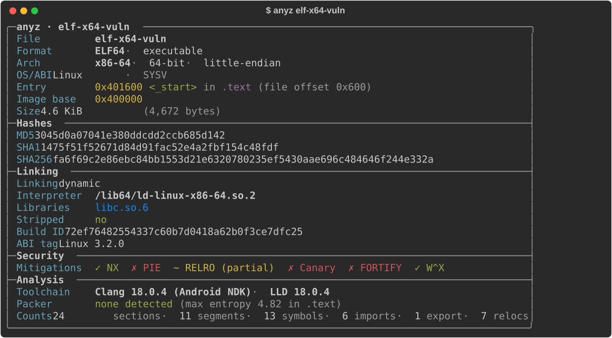
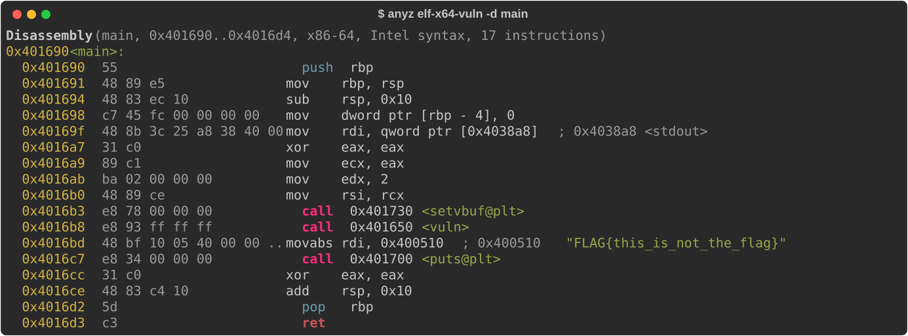
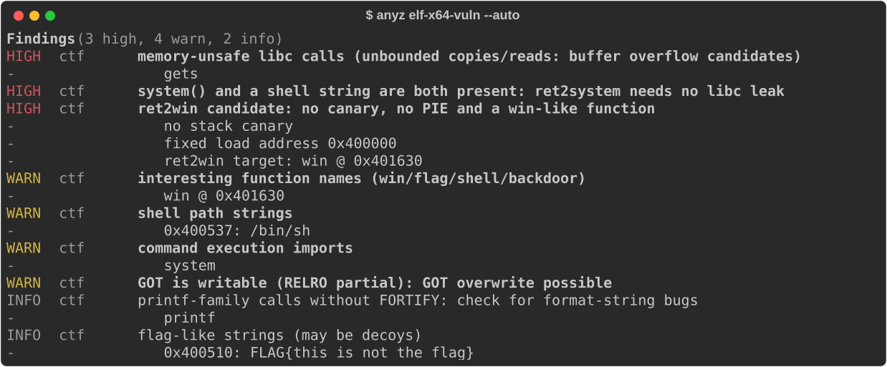
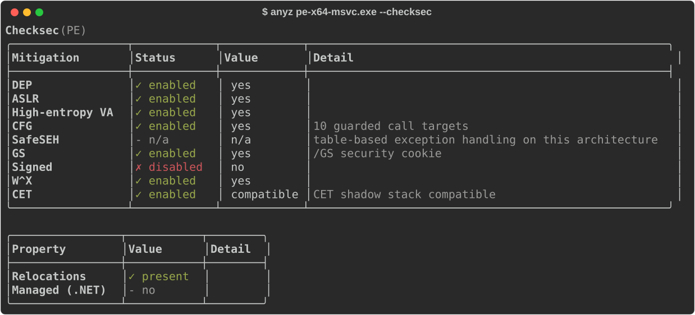
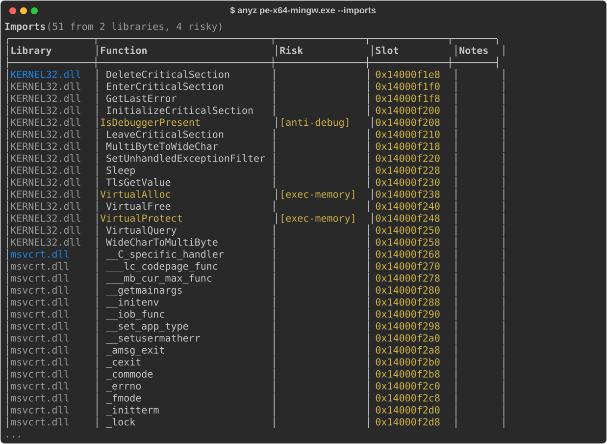
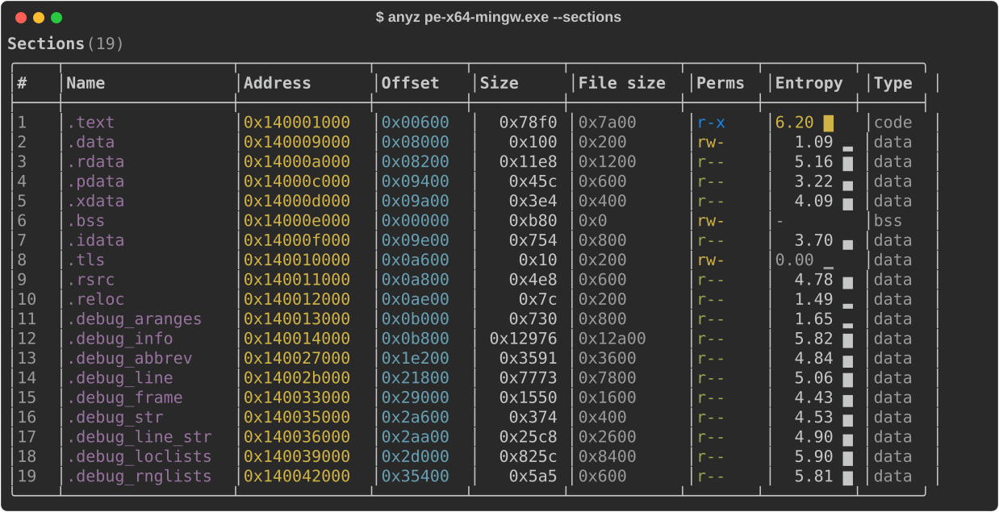
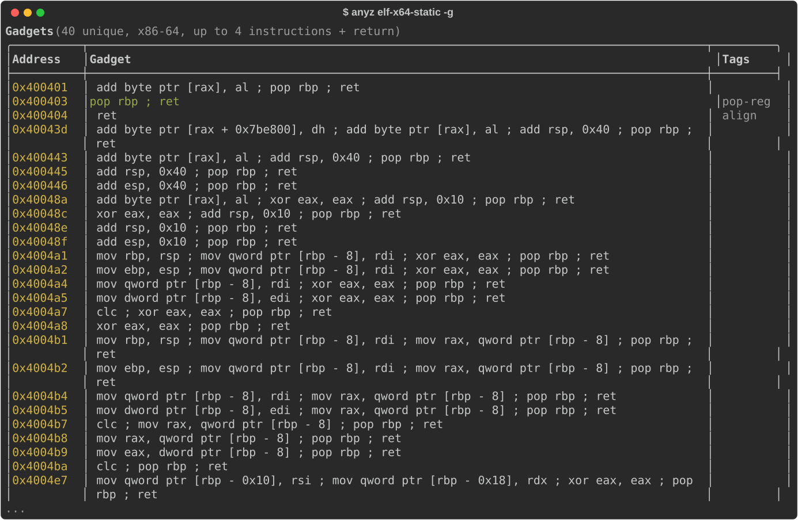
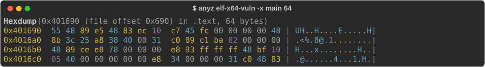

# anyz

One command for binary triage. `anyz` answers the first questions about an
unknown binary (what it is, how it is hardened, what it imports, where `main`
is, what it might do) for **ELF, PE and Mach-O**, including fat binaries and raw
shellcode. It covers the ground of `file`, `readelf`, `objdump`, `checksec` and
`rabin2` in one tool, with colored tables or JSON. It is built for CTF players,
reverse engineers and malware analysts.

<p align="center"></p>

## Install

Pushing a `v*` tag runs the release workflow, which attaches prebuilt binaries
for Linux x86-64 (static, musl), Windows x86-64 and macOS arm64 to the GitHub
release.

To build from source you need Rust 1.88 or newer and a C compiler (capstone is
compiled from source):

```
cargo install --path .
```

## Quick tour

```
anyz <binary> [flags]
```

| I want to... | Command |
|---|---|
| know what this file is | `anyz chall` |
| know where to start (ranked findings) | `anyz chall --auto` |
| see mitigations in detail | `anyz chall --checksec` |
| disassemble `main`, with calls and strings resolved | `anyz chall -d main` |
| disassemble 20 instructions from an address | `anyz chall -d 0x401136 -n 20` |
| disassemble a range | `anyz chall -d main +0x40` or `anyz chall -d vuln main` |
| translate an address (VA, RVA, file offset, section) | `anyz chall -o main+0x2d` |
| hex dump by address or by file offset | `anyz chall -x main 64`, `anyz chall -x off:0 64` |
| find who calls a function | `anyz chall -X system` |
| list ROP gadgets | `anyz chall -g \| grep 'pop rdi'` |
| search for bytes or text | `anyz mal.exe -f 'e8 ?? ?? ?? ?? 85 c0'`, `anyz mal.exe -f wide:Software` |
| extract strings, including UTF-16 | `anyz mal.exe -z --utf16 -n 6` |
| see imports with risky APIs flagged | `anyz mal.exe -I` |
| see the PLT and GOT | `anyz chall --plt --got` |
| disassemble raw shellcode | `anyz sc.bin --arch x86-64 -d` |
| look at one slice of a fat binary | `anyz app --slice x86_64` |
| get any of the above as JSON | `anyz chall --checksec --json \| jq .checksec` |

## Views

With no flags, `anyz` prints the info panel. View flags can be combined; the
views always print in the same order (info, findings, checksec, sections,
segments, entropy, symbols, imports, exports, PLT, GOT, relocations, strings,
find, xrefs, gadgets, offsets, hexdump, disassembly).

| Flag | Shows |
|---|---|
| *(none)*, `-i, --info` | Info panel: format, arch, entry, hashes (MD5, SHA-1, SHA-256, PE imphash), linking, mitigations, toolchain guess, packer hints, counts. |
| `-a, --auto` | Info panel plus ranked findings (see [--auto](#--auto-where-to-start)). |
| `--checksec` | Mitigations with details, then related properties: RPATH, RUNPATH, TEXTREL and stripped symbols (ELF), relocations and .NET (PE). |
| `-S, --sections` | Sections: address, file offset, size, file size, permissions (W+X in red), entropy, type. |
| `-l, --segments` | Program headers or Mach-O segments, with the sections each one maps. |
| `-s, --symbols [REGEX]` | Symbols, demangled (C++, Rust) and colored by kind. The optional regex is case-insensitive unless it contains capitals. |
| `-I, --imports` | Imports grouped by library: GOT/IAT slot, PLT/stub address, and a risk tag such as `memory-unsafe`, `exec`, `injection`, `exec-memory`, `anti-debug`, `dynamic-api`, `network`, `persistence`, `crypto`, `privilege` or `keylogging`. |
| `-E, --exports` | Exports, with ordinals and forwarders for PE. |
| `--plt` | ELF PLT entries (x86, x86-64, ARM, AArch64, RISC-V) and Mach-O stubs, with the function each one jumps to. |
| `--got` | GOT slots (ELF, Mach-O) or IAT entries (PE), with the value stored in the file. |
| `-r, --relocs` | Relocations: every ELF relocation section (`.rela.dyn`, `.rela.plt`, `.rela.text`, ...), read from the dynamic table when section headers are missing; PE base relocations. |
| `-e, --entropy` | Per-section entropy with bars, and a sparkline of the whole file. |
| `-z, --strings` | Printable strings in the whole file with offset, VA and section. `-n N` sets the minimum length (default 4); `--utf16` adds UTF-16LE strings. |
| `-d, --disasm [FROM [TO]]` | Disassembly (see [Disassembly](#disassembly)). |
| `-o, --offsets ADDR` | One address in every address space: VA, RVA, file offset, section and offset into it, segment, symbol, and the bytes there. |
| `-x, --hexdump ADDR [LEN]` | Hex dump, 256 bytes by default. A dump at a VA stops at the end of the file-backed mapping; an `off:` dump reads raw file bytes. |
| `-f, --find PATTERN` | Byte or string search over the whole file (see [Search, xrefs, gadgets](#search-xrefs-gadgets)). |
| `-X, --xrefs ADDR` | Instructions that reference ADDR. |
| `-g, --gadgets` | ROP gadgets ending in a return. `--depth N` sets the most instructions before the return (default 4). |

Output and loading options:

| Flag | Effect |
|---|---|
| `-j, --json` | One JSON object with a key per selected view. |
| `--no-color` | Plain ASCII output. This is automatic when stdout is not a terminal or `NO_COLOR` is set; `FORCE_COLOR=1` keeps colors when piping into `less -R`. |
| `--arch ARCH`, `--base ADDR` | Treat a raw blob as code for ARCH loaded at ADDR (default 0). ARCH is one of x86, x86-64, arm, armbe, thumb, arm64, mips, mipsel, mips64, mips64el, riscv32, riscv64, ppc, ppc64, ppc64le, sparc, sparc64, m68k, s390x, loongarch64. |
| `--slice ARCH` | The slice of a fat Mach-O to analyze. Without it, anyz picks the slice matching the host and otherwise lists the slices. |

## Address expressions

Every flag that takes an address (`-d`, `-o`, `-x`, `-X`) accepts the same
expressions. A bare number is a virtual address. Names are looked up as
symbols (raw or demangled; Mach-O's leading `_` is optional), then imports,
then sections.

| Expression | Meaning |
|---|---|
| `0x401136`, `4198710`, `0o20010466`, `0b1010`, `0x40_1136` | numbers (hex, decimal, octal, binary; `_` separators allowed) |
| `main`, `sym.main`, `ctf::check`, `"operator new(unsigned long)"` | symbols; quote names that contain spaces or `+`/`-` |
| `main+0x20`, `win - 4`, `.text+0x100` | arithmetic with `+` and `-` |
| `puts@plt`, `printf@stub`, `sym.imp.puts`, `imp.puts` | an import's call stub (PE: its IAT slot) |
| `puts@got`, `KERNEL32.dll!Sleep`, `kernel32!Sleep`, `ws2_32!#23` | an import's pointer slot (GOT or IAT entry) |
| `.text`, `__TEXT,__text` | start of a section |
| `entry`, `base` | entry point, image base |
| `off:0x690`, `rva:0x1000`, `va:0x401690` | an explicit address space |
| `off:main+4` | names are converted into the prefix's space: the file offset of `main`, plus 4 |

Errors say what went wrong and suggest a fix:

```
$ anyz chall -d mian
anyz: error: unknown symbol 'mian' (did you mean main, win, vuln?)
$ anyz prog.exe -d 0x1000
anyz: error: '0x1000': address 0x1000 is not inside any mapped section or segment (did you mean rva:0x1000 or off:0x1000?)
$ anyz chall -x off:stdout
anyz: error: 'off:stdout': address 0x4038a8 is in .bss, which has no file backing (zero-filled at load time)
```

## Disassembly

<p align="center"></p>

* `-d` alone starts at `main` if there is one, else at the entry point.
* `-d FROM` disassembles a whole function when FROM is a sized function symbol,
  and 48 instructions otherwise. `-n N` sets the number of instructions.
* `-d FROM TO` and `-d FROM +LEN` disassemble a range.
* Branch targets are labeled with symbols and import stubs (`<win>`,
  `<puts@plt>`). Data references (RIP-relative and absolute operands, AArch64
  `adrp` pairs, RISC-V `auipc` pairs, ARM literal pools) show the symbol or the
  string they point to.
* `--syntax att` switches x86 to AT&T syntax. ARM code switches to Thumb on its
  own (mapping symbols, odd addresses, Thumb function symbols), or with
  `--thumb`.
* Supported architectures (via capstone): x86, x86-64, ARM and Thumb, AArch64,
  MIPS (32/64-bit, either endianness), RISC-V (32/64-bit), PowerPC (32/64-bit),
  SPARC, SPARCv9, s390x and m68k.

## Search, xrefs, gadgets

`-f PATTERN` searches the whole file, including headers, overlays and resources.
Each match lists the file offset, VA, section, containing symbol and bytes.

| Pattern | Matches |
|---|---|
| `'de ad ?? ef'`, `0xdeadbeef`, `hex:4883ec??` | bytes; `??` matches any byte |
| `str:cafe`, or any other text | the literal string |
| `wide:Software` | the string encoded as UTF-16LE |

`-X ADDR` sweeps every executable section for instructions whose branch target
or data reference hits ADDR, or anywhere inside the data object at ADDR. For an
import, references to its stub and to its GOT/IAT slot are included. In shared
libraries, calls through a function's own PLT entry are included too.

`-g` lists unique gadgets for x86 and x86-64 (including unaligned
instructions), ARM, AArch64 and RISC-V. Gadgets that contain other control flow,
or instructions that fault in user mode (`int3`, `hlt`, `in`, `out`, ...), are
dropped. Tags mark `pop-reg` (only pops), `syscall`, `pivot` (stack pointer
changes) and `align` (a bare `ret`).

## --auto: where to start

`--auto` prints the info panel followed by findings ranked HIGH, WARN and INFO.

<p align="center"></p>

* **CTF and exploitation:** memory-unsafe calls (`gets`, `strcpy`, ...);
  `system()` together with a `/bin/sh` string (ret2system); ret2win (no canary,
  no PIE, and a win-like function); a writable GOT; static binaries at a fixed
  address (plenty of ROP gadgets); `printf` without FORTIFY; seccomp filters; an
  executable stack; flag-like strings; interesting function names.
* **Malware triage:** process injection; executable memory; anti-debugging;
  APIs resolved at run time behind a tiny import table; persistence, keylogging,
  crypto, privilege and network APIs; URLs and IPv4 addresses; telltale strings
  (autorun keys, shadow-copy deletion, encoded PowerShell, LOLBins, reverse
  shells, `LD_PRELOAD`, VM and sandbox checks); packers; RWX or high-entropy
  sections; unusual PE section names; TLS callbacks; overlays; forged
  timestamps; bad checksums; missing signatures; .NET assemblies.
* **General:** stripped binaries or debug info present, RPATH/RUNPATH, and
  anything the loader had to work around.

Findings are hints about where to look, not verdicts.

## JSON

`--json` prints one object holding `file` and one key per selected view:
`info`, `auto`, `checksec`, `sections`, `segments`, `symbols`, `imports`,
`exports`, `plt`, `got`, `relocs`, `entropy`, `strings`, `find`, `xrefs`,
`gadgets`, `disasm`, `offsets`, `hexdump`. Addresses are numbers and byte
strings are hex.

```
anyz chall --auto --json | jq -r '.auto.findings[] | "\(.severity)\t\(.title)"'
anyz mal.exe -I --json | jq -r '.imports.libraries[].imports[] | select(.risk) | .name'
anyz chall -g --json | jq -r '.gadgets.gadgets[] | select(.tags | index("pop-reg")) | .text'
```

## More screenshots

| | |
|---|---|
| `--checksec` on an MSVC PE<br> | `--imports` on a MinGW PE<br> |
| `--sections` with entropy<br> | `--gadgets` on a static ELF<br> |
| `-x main 64`<br> | |

The screenshots are produced from real output by `docs/make_screenshots.py`
(`pip install rich`, then `python docs/make_screenshots.py`).

## What the info panel checks

* **ELF:** NX, PIE, RELRO (none/partial/full), stack canary, FORTIFY (fortified
  and fortifiable calls), W^X, CET (IBT/SHSTK), AArch64 BTI/PAC; RPATH/RUNPATH,
  build ID, ABI tag, symbol versions.
* **PE:** DEP, ASLR (including the stripped-relocations case), high-entropy VA,
  CFG, SafeSEH, /GS, Authenticode presence, CET compatibility; imphash
  (compatible with pefile), Rich header, PDB path, reproducible-build
  timestamps, TLS callbacks, overlay, checksum validity, delay-load imports,
  .NET/CLR.
* **Mach-O:** PIE, code signature (ad-hoc or certificate, identifier, team ID),
  hardened runtime, canary, NX stack, ARC, encryption; platform, minimum OS and
  SDK, UUID.
* **Toolchain guess:** GCC, Clang and LLD versions, MSVC (Visual Studio
  version), MinGW, Go (version), Rust, C++, .NET, Delphi, Nim, Swift and
  Objective-C, PyInstaller, AutoIt.
* **Packer hints:** UPX, ASPack, MPRESS, Themida, VMProtect and others by
  section names and signatures, and sections with entropy above 7.2.

## Design

```
src/
  main.rs     CLI -> load -> analyzers -> render, on a worker thread with a 64 MiB stack
  cli.rs      clap definitions
  addr.rs     address expression parser and resolver
  model.rs    unified Binary model; VA <-> RVA <-> file offset conversion
  loader/     format detection; elf.rs, pe.rs, macho.rs (with fat), raw.rs -> Binary
  analyzers/  info, checksec, sections, symbols, strings, entropy, disasm, offsets,
              hexdump, find, xrefs, gadgets, auto: Binary -> report structs
  render/     layout.rs (report -> styled document); pretty.rs, plain.rs, json.rs
```

* Only the loaders touch goblin. Analyzers see the unified model and return
  plain serde structs; renderers do all formatting, so every view has the same
  pretty, plain and JSON forms.
* Model addresses are virtual addresses. RVA = VA - image base; file offsets go
  through an explicit region map, with typed errors for unmapped addresses,
  zero-filled memory such as `.bss`, and offsets past the end of the file.
* Files are memory-mapped and views are computed on demand. On a 184 MiB DLL,
  the info panel takes under a second and `--strings` (2 million strings) about
  4 seconds.
* Hostile input is expected. Parsing is bounds-checked, parser panics are
  contained, and a fuzz test mutates the fixtures and runs every view on them.
  Where goblin was wrong or unsafe on malformed input, anyz parses the
  structure itself (PE load config and data directories, the Mach-O export trie
  and the `LC_MAIN` entry point).

## Testing

`cargo test` runs:

* unit tests for address expressions, address-space conversion, search
  patterns, string extraction, risk classification and gadget filtering;
* integration tests that run the binary on the fixtures, with expected values
  taken from llvm-readelf, llvm-objdump and pefile (PLT tables and disassembly
  were compared against objdump);
* a fuzz test that runs every view on mutated fixtures (`ANYZ_FUZZ_ROUNDS` and
  `ANYZ_FUZZ_SEED` control it).

CI runs `cargo fmt --check`, `cargo clippy --all-targets -- -D warnings` and
the tests on Linux, Windows and macOS, and checks that the code builds with
the minimum supported Rust version (1.88).

`tests/fixtures/bin/` holds small binaries built from `tests/fixtures/src/`:
ELF x86-64 (a no-PIE CTF target, a hardened C++ PIE, a stripped copy, a static
RWX binary), PE32+ (MinGW executable, a DLL with ordinal and forwarded exports,
MSVC with CFG), PE32 (MSVC with SafeSEH), Mach-O arm64 and x86-64, a fat
binary, and raw shellcode. `tests/fixtures/build.sh` rebuilds them with clang,
lld and MinGW-w64 on any host (stub `libc.so.6` and `libSystem.tbd` provide the
symbols); `tests/fixtures/build_msvc.cmd` rebuilds the MSVC ones on Windows.

## Limitations

* Disassembly is a linear sweep: no control-flow graph, function discovery or
  decompiler. Data mixed into code can produce bogus instructions.
* Cross-references cover direct branches and the address patterns listed
  above. Indirect calls through registers and computed addresses are not
  resolved.
* Gadgets end in returns only (no JOP/COP gadgets).
* DWARF and PDB debug info is detected but not parsed.
* Mach-O rebase and bind opcodes are not shown as relocations.
* JSON addresses are 64-bit integers. JavaScript and jq older than 1.7 round
  values above 2^53, such as kernel addresses.

## License

Licensed under either of [Apache License, Version 2.0](LICENSE-APACHE) or
[MIT license](LICENSE-MIT), at your option.

Unless you explicitly state otherwise, any contribution intentionally submitted
for inclusion in anyz by you, as defined in the Apache-2.0 license, shall be
dual licensed as above, without any additional terms or conditions.
